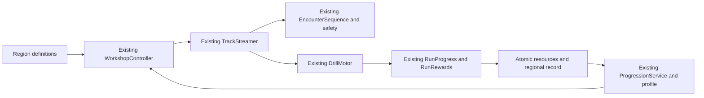

# M9-A - Regions, Quarry and Iron validation

Historical M9-A checkpoint: M9-B now supplies the two deferred regions and advanced ores. See [M9-B validation](M9-B-Validation.md) for current availability and complete progression; M9-A's recorded tests and economy measurements below remain historical evidence.

Unity **6000.3.8f1**, URP 3D, Windows PC Editor, portrait **9:16**. Task-start `main` was clean at **ed3f9516f84531294264c582bd85fb9ef0d56f06**, “feat: complete M8 evolution and rapid run economy”. A live `git ls-remote origin refs/heads/main` returned that same commit, verifying the approved M8 checkpoint was committed and pushed before M9-A. The task-start snapshot contains **775 files**. Nothing was committed/pushed/reset/reverted/discarded during M9-A. No real profile was read, reset or compensated for testing.

## Implemented regions and selection

| Stable ID | Display name | Eligibility | Content in this build | Resources |
|---|---|---:|---|---|
| `workshop_yard` | Workshop Yard | EVO 1 | Playable, existing course | Copper |
| `quarry` | Quarry / Scrapworks | EVO 3 | Playable, new industrial course | Iron |
| `advanced_works` | Advanced Works | EVO 5 | Metadata only / NOT IN THIS BUILD | Future Quartz / Alloy Core |
| `high_energy` | High Energy | EVO 7 | Metadata only / NOT IN THIS BUILD | Future Energy Shard |

Workshop has one compact region selector. Its four-row drawer shows current selection, availability/lock, stage, resources and independent best distance. Selecting a playable region commits through the existing service; no confirmation screen or new game mode. It cannot change during a run, pending bank or evolution. Unlocking Quarry does **not** force entry; Yard remains selected until chosen otherwise. Return travel remains available. Deferred regions have no track, environment or encounter references and cannot launch even on EVO 8.

The new region bar fits above the existing upgrade cards. Preview dimensions preserve its texture aspect ratio; the existing glow is fitted to the smaller card. The second resource pill is contextual (Iron in Quarry, Copper in Yard). The old upgrade/evolution/Start controls remain. Results show the earned resource for the actual run, and a small header shows region and best distance with consistent whole-meter display.

## Runtime architecture

`RegionDefinition` / `RegionCatalog` are authored ScriptableObjects containing stable identity, unlock, catalogs, introduction/environment, materials/resources and sky metadata. `WorkshopController` remains the lifecycle owner. It resolves selection between attempts, applies the selected configuration to the **same TrackStreamer**, and starts/retries through the existing motor/input/run path.

Yard retains its original authored starters, catalogs and scene geometry. Quarry uses one own introduction, matching open fallback, 14 encounter sections and the existing bounded generated root. Switching back restores Yard's original references/sky; generated Quarry sections are retired/unregistered through the same cleanup. No duplicate motor, generator, checkpoint/run controller, inventory or save file.

Cadence becomes resource-generic through a `ResourceKind` setting, defaulting to Copper for existing assets. The old serialized Copper pacing field names are retained for compatibility; Quarry uses Iron for that cadence. Starting Ore witnesses apply to both special resources. Seed RNG, categories, full-footprint routes, transition checks and all approved Yard scheduling remain intact. Only Quarry changes sky/fog colors at runtime; camera transform, FOV and follow are unchanged.

## Quarry art, materials and rewards

The original toy-industrial geometry uses cool gray rock formations, reinforced deck, conveyors/rollers, steel supports, hoist structures, amber machinery and work-lamp shapes, and silver Iron deposits. All dressing is combined into shared-material meshes. No new runtime lights, ambient source pool or music pipeline. Decorative geometry stays outside the corridor (ground/deck details are visual only) and has **zero colliders**. Every playable section has only its floor collider and authored obstacle colliders.

| Material | Stable ID | Hardness / minimum Power | Durability | Raw material rate | Full destruction payout |
|---|---|---:|---:|---:|---:|
| Granite | `granite` | 18 | 260 | 18 | 300 Coins |
| Metal Plating | `plating` | 26 | 420 | 24 | 600 Coins |
| Reinforced Block | `reinforced` | 40 | 620 | 32 | 1,000 Coins |
| Iron Ore | `iron_ore` | 18 | 240 | 20 | **6 Iron, 0 Coins** |

Coin amounts use the existing multiplier 25 (raw amounts 12/24/40); Iron bypasses that multiplier. Granite is available at Industrial base Power 20. Plating unlocks at Industrial Power level 3 (26). Reinforced Blocks unlock at Heavy Borer Power level 3 (42; the fixed material threshold is 40). These thresholds never change with stage. Existing Wood 2 / Brick 5 / Stone 9 remain untouched. Distinct surface facets, ribs/bolts, reinforcement bands and silver deposits identify materials; the HUD shows their exact hardness/Power.

Actual Industrial base drilling rates remain **3.6 / 3.9 / 4.3 / 3.7 Energy/s** for Granite/Plating/Reinforced/Iron, derived from the unchanged form base + 0.05 x material rate. No Capacity, consumption, charge, speed, damage or price table changed. Yard remains **6 Coins/5 m, Wood 25, Brick 50, Stone 75, Copper 3**. There is no regional passive Coin bonus.

Iron is the existing M8 resource, not another currency. `ObstacleRewardKind.Iron` is appended after existing serialized Coins/Copper values. The current ledger grants it once, only for a fully destroyed bound obstacle. Partial damage, bypasses, BLOCKED and repeated events award nothing. Iron reuses the bounded ore break/reward audio cues and existing particle pools, with silver/blue material color and IRON toast; normal industrial blocks award Coins only. Sound assets are unchanged.

## Encounter and movement safety

Quarry has all six categories: Easy Flow, Dense Drilling, Risk/Reward, Precision Escape, Power Test and Recovery. Patterns are new arrangements/material mixes, not recolored Yard prefabs. They include a three-Granite line, optional gated plating, parallel Power choices, staggered reinforced hazards, unguarded Iron pairs, guarded Iron pairs and open recovery. The first encounter is a calm resource opportunity; Iron is around 60-70 m, not hundreds of meters away. Later patterns and relief/resource cadence remain deterministic.

The section width/length remain **6 x 40 m**, with the accepted 1.7 m full footprint, front/rear extent and 26 speed ceiling. Reaction allowance remains **0.35 s** followed by actual exponential steering response. All 14 patterns have a clear constant-X full-footprint bypass and separately certified starting-Power Ore line; all 196 ordered joins satisfy the conservative transition envelope. The Ore validation budget is 90 (raw material-cost witness), without modifying actual operating costs. One first-authoring reinforced block at Z=31 failed the legacy hard-obstacle end-clearance rule and was corrected to Z=30 through Editor APIs before integration.

Validation includes deterministic replay over five seeds x 256 selections; minimum/upgraded EVO 3, base/MAX EVO 4 and returning EVO 8; **70 actual reaction-aware opposite-side bypass fixtures**; paid Power 20 versus 26 plating contact and BLOCKED escape; mixed-policy natural Energy runs; and bounded registration/stream cleanup. Static witnesses establish available routes, not an absolute safety guarantee for arbitrary human input. Diagnostic fixtures teleport to a controlled section and force cleanup only after assertions; their rewards/records are excluded from economic measurements.

## Actual gameplay distributions

**160 Quarry attempts**: eight representative form/level profiles x seeds 1337/904/2026/8101/9201 x four existing policies. Base/intermediate/MAX profiles use temporary funded selection to set parameters only. Exported income is the earned ledger, not the funded wallet. The actual motor, HP, contacts, steering, material costs, streamer, rewards and banking execute until natural empty Energy; no time/distance cap, altered requirements, refills or material relocation in these samples.

Safe is a pure avoidance control; Resource is an Ore-focused control. Balanced and Power take affordable normal materials and resource opportunities. The table uses balanced five-seed medians; ranges show observed duration variation. Components are aggregated separately.

| Profile | Seconds median (range) | Meters | Coins (distance + obstacle) | Iron | Drilling Energy | Granite / Plating / Reinforced / Iron breaks |
|---|---:|---:|---:|---:|---:|---:|
| Industrial base | 21.52 (18.74-21.52) | 158.1 | 1686 (186+1500) | 12 | 32.28 | 5 / 0 / 0 / 2 |
| Industrial intermediate | 22.86 (21.32-23.64) | 196.7 | 1734 (234+1500) | 12 | 26.90 | 5 / 0 / 0 / 2 |
| Industrial MAX | 27.19 (26.58-28.43) | 253.6 | 2100 (300+1800) | 12 | 24.64 | 6 / 0 / 0 / 2 |
| Heavy base | 21.80 (20.58-22.41) | 203.8 | 1740 (240+1500) | 12 | 20.64 | 5 / 0 / 0 / 2 |
| Heavy intermediate | 23.81 (23.51-24.54) | 235.2 | 2076 (282+1800) | 12 | 19.35 | 5 / 0 / 0 / 2 |
| Heavy MAX | 29.48 (29.23-30.43) | 289.8 | 3342 (342+3000) | 12 | 23.95 | 8 / 1 / 0 / 2 |
| Hydraulic base | 22.76 (21.93-23.13) | 230.0 | 2370 (270+2100) | 12 | 17.78 | 5 / 0 / 0 / 2 |
| Quantum MAX | 32.33 (32.12-32.51) | 394.1 | 4774 (468+4300) | 12 | 6.83 | 9 / 1 / 1 / 2 |

Normal destruction supplies most Quarry Coins, rather than passive distance. Base Industrial balanced medians are about **89% normal-obstacle income** (1,500/1,686). Higher Power unlocks valuable materials and reduces their time/cost; greater Capacity/Drive extend endurance/reach with unchanged operating rates. Middle MAX runs can approach **30-31 active seconds** because drilling consumes less per second than travel; this is natural existing behavior, not a new timer. All eight forms remain functional; later-region economic balance is still deferred.

### Honest strategy controls and goal-aware resource policy

Pure avoidance and Ore-only behavior deliberately forgo valuable normal mining. They are retained as controls, not represented as satisfying 10-15-attempt progression. After an Ore quota, the pure Resource driver still bypasses normal blocks; this produces a long Coin grind. The additional **goal-aware resource policy** explicitly prioritizes the required resource, then changes to balanced normal mining for Coins. Its choices and purchase order are logged, with no reward/stat/price changes. These are distinct experiments, not silent policy manipulation to hit a target.

| Strategy / starting form | Attempts to next form across three families |
|---|---:|
| Industrial / Safe | 42 |
| Industrial / Balanced | 9-10 |
| Industrial / Resource | 40-41 |
| Industrial / Power | 8-10 |
| Industrial / resource goal-aware | 10-11 |
| Heavy / Safe | 51 |
| Heavy / Balanced | 12 |
| Heavy / Resource | 47-49 |
| Heavy / Power | 11-12 |
| Heavy / resource goal-aware | 11-13 |

Pure controls reveal a meaningful limitation: refusing normal mining is slow (40-51 attempts) and can require several saving attempts between expensive upgrades. It is not an engine deadlock: there is steady forward income, safe routes, and normal mining remains available. Making that control equally fast would require passive inflation or price reductions, which would undermine M8-R4. This tradeoff is exposed for owner review. Resource-goal play is **10-11 / 11-13 attempts**, while balanced play is **9-10 / 12** from fresh middle-form profiles. No requirement is bypassed. Targets are approximate; the game never enforces an attempt count or mandatory purchase.

The separate middle-stage experiments use **zero current-form Coins/Copper/Iron/current upgrades**, with valid prior purchased ownership supplied only to choose the starting form. They are not proof of the earlier acquisition history; the full journeys below provide that proof.

## Fully unfunded production-reachable journeys

Three complete profiles start from fresh Pocket, **zero Coins and resources**, and reach EVO 5 through actual travel, destruction, banking, all 15 paid purchases per form and real evolution transactions. No temporary stage, funding, injected stats or resource grant is used. Fixed seeds and synthetic player steering make them reproducible.

| Family | Attempts EVO 1 / 2 / 3 / 4 | Total to EVO 5 | Active seconds in EVO 3 / 4 | Middle Coins earned EVO 3 / 4 | Yard return runs during EVO 4 | Coin balance at EVO 5 |
|---|---:|---:|---:|---:|---:|---:|
| 10300 | 14 / 14 / 9 / 12 | 49 | 199.09 / 287.13 | 15414 / 22120 | 4 | 1855 |
| 8100 | 14 / 14 / 9 / 11 | 48 | 205.94 / 273.96 | 15840 / 23844 | 4 | 4124 |
| 9200 | 14 / 14 / 10 / 12 | 50 | 221.32 / 285.02 | 14940 / 21491 | 4 | 859 |

The journeys complete EVO 3 -> 4 in **9-10** and EVO 4 -> 5 in **11-12 additional attempts**, including four legitimate Yard visits for the required 12 Copper. Middle active play is about **199-221 s + 274-287 s**, or roughly eight minutes total. The first middle transition is slightly faster than the loose 10-15 target; rewards were not distorted simply to force an exact count. Whole-game active time to EVO 5 is approximately 15-16 minutes, excluding Workshop/charging/presentation time.

Each family earns **36 Iron** during EVO 3, spends 30 and carries 6. During EVO 4 it earns another **48**, then spends the exact 50 Iron + 12 Copper. Ordinary acquisition stops at EVO 5 because no Quartz source/Region 3 exists yet. Existing stored later-form resources and all eight forms are still preserved and structurally functional.

**Prices/requirements are unchanged:** Industrial MAX upgrades total **15,050 Coins + 30 Iron evolution**; Heavy total **20,650 Coins + 50 Iron and 12 Copper evolution**. All categories must reach MAX. Earnings and accumulated balances are distinct: one family earns 14,940 in Industrial but legitimately enters with 128 saved Coins, pays 15,050 and retains 18. No false claim that that stage alone funded the entire budget. Purchases happen regularly; the exports contain each run's new Coins, resulting wallet and paid purchase count.

## Save, banking and records

The same Version-1 checksum envelope, profile path, atomic store, backup/recovery, balances, upgrades, ownership and durable attempt receipts remain. Additive `RegionSchema`, `SelectedRegionId` and at most four `RegionRecords` use stable IDs and finite nonnegative best distances. Legacy schema 0 means Yard/empty regional records without rewriting the file on load. Selection and the first actual regional bank materialize the extension on normal transactions. There was no previous persistent distance field to remap.

The run captures region identity at creation and binds it to its issued attempt. The existing service commits **Coins, Copper, Iron and that region's best distance atomically**, publishing only after durable success. Repeated/late receipts cannot duplicate resources or improve a record again. Aborted/QA-reset attempts do not bank. Partial Iron, bypasses and normal metal blocks cannot grant Iron. Snapshots and candidate transactions deep-copy both the region array and its entries; failed writes cannot mutate an existing record. Records survive selection, retries, evolution and reload, independently for both regions.

Unknown/locked IDs, unsupported regional schema, invalid record IDs, duplicate records and nonfinite/negative distances are rejected with the original store preserved read-only. Known deferred region metadata cannot launch; runtime resolves a supported but unavailable saved selection to Yard in this development build. Existing backups and all legacy migration checks remain. Temporary profiles reuse the existing memory store; selection, resources, records and evolution remain isolated from the real profile. Tests use memory or unique OS-temp stores, never the real player file.

## Editor setup, authoring and preservation

Run **Tools > DrillRunner > Setup M9-A Regions and Quarry** (`DrillRunner.Editor.RegionSetup.Setup`). It creates the region definitions/catalog, four material assets, four obstacle prefabs, shared environment, 16 section prefabs, encounter data and compact selector, then wires the existing Gameplay scene through Editor APIs. All materials/models follow the existing procedural toy-art workflow. No manually edited scene/prefab YAML, manual wiring, source art replacement or package dependency.

Healthy reruns validate the configured assets and return without rewriting owner work. The full Assets snapshot test runs setup twice, checks every byte/GUID and the file set, and respects dirty-scene protection. Existing setup commands and Fresh Pocket / EVO 1-8 temporary stage/resource controls remain. For quick Quarry QA, choose temporary EVO 3 or 4 with current upgrades/resources as desired, then select Quarry in the normal Workshop. Temporary Iron is a structural QA shortcut only, not a production reward.

The original committed asset/configuration/metadata set is byte-preserved. All **390 original scene object IDs remain**, and all **25 original world-transform, camera, light, physics and render-setting blocks are identical**. Scene changes add/wire the region UI/catalog and fit only the Workshop preview area; approved 3D geometry, player/camera transforms and tuning stay intact. Snapshot/audit evidence is under `Logs/M9A-Baseline.json` and `M9A-Preservation.json`.

## Files and implementation boundaries

New runtime files: `RegionDefinition.cs` (stable IDs/record metadata and definition), `RegionCatalog.cs`, `RegionWorkshopView.cs`. Existing runtime changes are narrowly in `PlayerProgress`, `ProgressionService`, `RunRewards`, `RunProgress`, `MaterialDefinition`, `TrackCatalog`, `TrackStreamer`, `EncounterLibrary/Sequence/Safety`, `TrackSafety`, `WorkshopController/View`, `PrototypeHud`, and shared presentation for Iron. `DrillMotor`, movement integration, all eight progression/price assets, RapidRunBalance, existing art/sound/prefabs and input/camera tuning are untouched.

Editor: new `RegionSetup.cs`; the existing Inspector eligibility caption acknowledges later deferred content. Tests: new `RegionTests.cs`, `RegionPlayModeTests.cs`, `RegionVisualPlayModeTests.cs`; existing simulation exports now use an M9-A prefix, and the test-only policy/sample supports the actual resource kind and earned Iron. Yard policy semantics are retained. README documents the new entry point. Full paths and new asset lists are in the final preservation/Git audit.

## Actual Unity execution

The final complete suites ran sequentially in Unity 6000.3.8f1. PlayMode used **Direct3D11 graphics**.

- **217/217 EditMode passed, 0 failed, 0 skipped**, exit **0**, **31.40 s**. Evidence: `Logs/M9A-EditMode.xml` and `.log`.
- **104/104 PlayMode passed, 0 failed, 0 skipped**, exit **0**, **990.25 s**. Evidence: `Logs/M9A-PlayMode.xml` and `.log`.
- All **196 previous EditMode and 95 previous PlayMode case names remain**, with **21 new EditMode and 9 new PlayMode** cases. No previous case was removed, weakened or skipped. The test-only driver now handles the actual resource kind and exports Iron; its Yard behavior is unchanged.
- **All 300 matched Yard production samples exactly match M8-R4**, including seconds, distance, Coin/Copper income, state Energy/time, contacts and opportunities (ignoring the CSV mode label and added Iron column). Existing prices, RapidRunBalance, all eight form assets and other production content are byte-preserved.
- New economic workload: **160 static profiles**, **147 attempts in three complete fresh-to-EVO-5 journeys**, **670 attempts in 24 fresh middle-form pure-policy journeys**, and **66 attempts in six goal-aware resource journeys**. Every economic sample ends naturally from empty Energy and banks its actual earned ledger. Physics diagnostic cleanup/funded visual selection is excluded from income claims.
- Focused targeted validation passed **3/3**, zero failures/skips (`Logs/M9A-Targeted.xml`): reaction-aware Quarry bypasses, actual paid-Power plating/escape, and goal-aware progression. This preceded the successful final full suites; it is not added twice to unique case totals.
- Initial authoring caught a Unity ScriptableObject filename mismatch and a new reinforced block's conservative end clearance; both were corrected through code/Editor APIs. Initial new-test compilation used an assertion unsupported by Unity's installed NUnit and was corrected. The first executed EditMode run was 215 pass / 1 new deep-copy failure; fixing the regional record deep copy and adding failed-bank rollback coverage produced 217 passing cases. Initial calibration was 1 pass / 2 selector teardown errors; scene-unload null guards fixed the new UI lifecycle. The next focused run was 6 pass / 1 bypass-fixture cleanup failure; ending that diagnostic profile between configurations fixed the fixture. Initial XML/logs remain under their Initial/Focused/Calibration paths. Final results above supersede them; no unrelated gameplay fix or test removal was used.

The existing Editor idempotence regression plus the new full-snapshot test invoke configured setup repeatedly, compare every Assets/metadata byte and file set, and preserve custom/dirty scene safeguards. The normal setup entry is already applied. No manual references, inspector wiring, save reset or JSON editing is needed.

## Graphics and runtime presentation evidence

Actual 540x960 (9:16) captures were taken and inspected after the final UI changes. Representative files under `Logs/`:

| State | Capture |
|---|---|
| Quarry locked at EVO 2 | `M9A-M8R4-Region-Locked-Evo2.png` |
| Quarry available at EVO 3; later content disabled | `M9A-M8R4-Region-Unlocked-Evo3.png` |
| Existing Yard moving/drilling/results | `M9A-M8R4-Evo1-L0-Moving.png`, `...-Drilling.png`, `...-Results.png` |
| Quarry gameplay / Granite | `M9A-M8R4-Quarry-Gameplay.png`, `...-Contact-granite.png` |
| Metal Plating / Reinforced | `M9A-M8R4-Quarry-Contact-plating.png`, `...-Contact-reinforced.png` |
| Partial Iron contact and confirmed destruction/reward | `M9A-M8R4-Quarry-Contact-iron_ore.png`, `...-Iron-Reward.png` |
| Results containing actual Iron and Quarry identity/record | `M9A-M8R4-Quarry-Evo3-L0-Results.png` and other base/MAX results |
| Contextual Iron balance and evolution requirements | `M9A-M8R4-Quarry-Evo3-L0-Workshop.png`, `...-Evo4-L5-Workshop.png` |

The helper's retained M8R4 filename prefix is only naming reuse; these are actual M9-A frames. The screen shows visible drill, gray quarry/steel/amber identity, independent escape space, distinct surface treatments, Iron-only pickup feedback, contextual Iron count and unchanged fast navigation. Disabled/deferred text has dark foreground for contrast, previews preserve their texture aspect ratio, and best-distance text uses the same whole-meter convention as Results. No new clipping was found in inspected final frames. The region drawer temporarily overlays the preview/cards while choosing, then closes on selection; evolution/Start remain visible.

Four normal-Update Quarry episodes also executed with the existing shared rotor/presentation/audio/VFX lifecycle. Contact captures pause only the motor clock briefly to hold a real reached partial-drilling state. They are screenshots, **not recorded animation footage or proof of human reaction comfort**. Resource/particle/cue assertions execute, but no physical listening session or subjective sound-quality claim is made. Parameter/visual screenshots use clearly marked temporary funded profiles; the fresh full-journey exports do not.

| Live profile | Active s | Meters | Coins / Iron | Peak active sections / targets | Peak Editor draws | Peak main thread ms | Peak GC bytes/frame |
|---|---:|---:|---:|---:|---:|---:|---:|
| EVO 3 level 0 | 18.74 | 180.0 | 810 / 12 | 8 / 21 | 287 | 18.72 | 218603 |
| EVO 3 level 5 | 27.55 | 252.3 | 2400 / 12 | 8 / 21 | 308 | 22.01 | 218978 |
| EVO 4 level 0 | 20.94 | 211.8 | 1452 / 12 | 8 / 21 | 293 | 8.35 | 15890 |
| EVO 4 level 5 | 30.67 | 284.7 | 4636 / 12 | 8 / 21 | 302 | 16.66 | 192545 |

Explicit-clock policy sweeps and normal-Update episodes can choose different routes because of charge/input/frame timing; the latter are separate validation, not extra statistical replicates of identical inputs. For example base Industrial's rendered route earned 810 rather than the five-seed controlled median 1,686. This variation is reported rather than conflated with wallet funding or a reward discrepancy.

## Performance limits and remaining risks

Observed live bounds are **8 active sections, 21 registered targets, 5 AudioSources and 5 ParticleSystems**. Shared mesh/material batches keep decoration lightweight; it adds no colliders, runtime lights or audio sources. Region switches retire and unregister old generated content through the existing streamer. The new UI refreshes from service revision/state and avoids allocating a deep snapshot every frame.

This is **Editor evidence**, including test/capture overhead, not a mobile/FPS guarantee. Existing Instantiate/Destroy streaming, UI layout changes and particle emission still produce allocations and main-thread spikes; future device profiling/pooling work may be warranted. No Android profiling/build, custom music system or broad optimization is included. Pure avoidance/Ore-only Coin grinding, near-30-second middle MAX runs, small portrait preview and human readability/route choice remain owner-review tradeoffs. EVO 6-8 regional economy is not claimed balanced without M9-B content.

## Four focused owner QA checks

1. Open **Gameplay**, enter Play and use **M4 Workshop > WorkshopController > QA: Fresh Pocket - 0 upgrades (no disk writes)**. Open Workshop's region drawer: Yard works, Quarry is locked before EVO 3, and later areas say NOT IN THIS BUILD. Verify the accepted short Yard launch/run/Results/upgrade loop.
2. Use the existing **temporary EVO 3** selector with zero Iron/current upgrades; choose Quarry in Workshop. Check the environment and clear routes, mine Granite and silver Iron, try/escape an undrillable metal block, then purchase Power toward 26. Verify only full Iron destruction awards 6, normal metal gives Coins, Results shows actual earned Iron and the region record.
3. Retry, return to Workshop, switch to Yard for Copper, then back to Quarry. Check correct catalogs/sky, retained balances/upgrades, independent records, no duplicate audio/VFX/geometry, and once-only earnings. Leave Play to confirm the real profile is restored. Automated save/reload tests cover persistence without requiring edits to real files.
4. For quick structural/evolution presentation QA, use the existing temporary MAX EVO 3 with 30 Iron, then MAX EVO 4 with 50 Iron + 12 Copper, and perform the normal evolution actions. These are explicit QA resources; the 147 unfunded gameplay attempts prove real acquisition separately. Verify costs are spent exactly, the next form works, and EVO 5's next region remains unavailable pending M9-B. Judge normal run feel and dynamic presentation manually.

## Reproduction, artifacts and final status

Use the applied **Tools > DrillRunner > Setup M9-A Regions and Quarry** entry. Run all EditMode tests, then all graphics-enabled PlayMode tests; the ordinary test fixtures regenerate the deterministic exports. Keep the project closed for headless execution. Evidence: `Logs/M9A-EditMode.xml`, `M9A-PlayMode.xml`, corresponding logs, `M9A-ValidationSummary.json`, `M9A-Preservation.json`, `M9A-QuarryProfiles.csv`, `M9A-MiddleJourneys.csv`, `M9A-PureStrategyControls.csv`, `M9A-GoalAwareJourneys.csv`, `M9A-FullJourneys.csv`, `M9A-LiveEpisodes.csv`, and the retained M8-R4-prefix regressions. Local Logs are ignored artifacts.

All 775 task-start files remain. The final preservation audit lists every modified/new path, validates GUID/metadata integrity and records Git status. Original form stat/price assets, RapidRunBalance, Yard geometry/materials/sounds/models, Packages and ProjectSettings remain byte-identical; all original scene objects and world settings are retained. No real save is used for tests. No commit, push, reset, revert, discard, M9-B, future ore/region gameplay, new currency/form/upgrade category, regeneration, monetization or Android work.

### Final working tree

Branch **main**, unchanged HEAD **ed3f9516f84531294264c582bd85fb9ef0d56f06**. Status: **27 modified / 145 untracked / 0 staged**, starting from a clean checkpoint. Relative to the 775-file snapshot: **27 existing files changed, 145 new files, 0 missing**. All **453 metadata files** have unique GUIDs and existing targets; no missing metadata. All **643 protected original files** remain byte-identical. Final inventory is in `Logs/M9A-Preservation.json` and `M9A-Git-After.txt`. Source/document whitespace checks pass. No commit or push. **Stop after M9-A for Project Owner review.**
